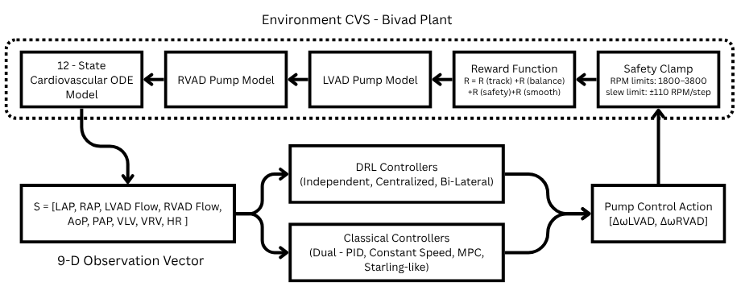
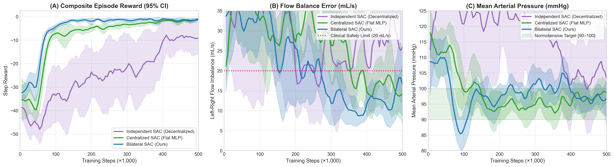

# Coordinated Physiological Control of Biventricular Assist Devices (BiVAD) Using Bilateral-Branch Soft Actor-Critic (SAC)

[](https://www.python.org/)
[](https://pytorch.org/)
[](https://stable-baselines3.readthedocs.io/)
[](https://gymnasium.farama.org/)
[](https://opensource.org/licenses/MIT)
[-purple.svg)](#13-license--citation)

---

## Overview

Biventricular heart failure carries severe morbidity and near-total mortality without mechanical circulatory support. While continuous-flow Left Ventricular Assist Devices (LVADs) are clinical mainstays for isolated left ventricular failure, total biventricular assistance (BiVAD) requires coordinated dual-pump actuation to balance the systemic and pulmonary circulations in real time. Independent decentralized controllers inevitably produce dangerous interventricular flow imbalances, precipitating fatal pulmonary edema (over-pumping) or ventricular suction collapse (under-pumping). Meanwhile, standard centralized deep reinforcement learning (DRL) policies suffer from an **Arterial Pressure Priority Trap**, where unpartitioned networks prioritize systemic arterial pressure at the expense of venous congestion and pulmonary vascular overload.

This repository provides the official implementation of **Bilateral-Branch Soft Actor-Critic (SAC)**, a biologically grounded deep reinforcement learning framework for closed-loop physiological BiVAD control. By incorporating an anatomical inductive bias—segregating systemic and pulmonary observation subspaces into dedicated left and right feature extraction branches before intermediate cross-ventricular coordination—the policy decouples dual-pump dynamics while preserving synchronized flow regulation. Benchmarked against clinical standard-of-care Constant Speed, decentralized Dual-PI feedback, physiological Dual Starling-like control, Centralized Multi-Objective Model Predictive Control (CMO-MPC), Centralized Flat SAC, and Independent Dual-Agent SAC across 9 clinical scenarios and 5 multi-phenotype virtual patients, Bilateral-Branch SAC eliminates ventricular suction, maintains normotension, and enforces strict flow conservation with sub-millisecond inference suitable for embedded clinical hardware.

---


## 1. Clinical Motivation & System Architecture

### The Clinical Problem
Advanced heart failure affects over 64 million individuals worldwide . For patients suffering from end-stage biventricular failure—where both the left and right ventricles cannot maintain adequate cardiac output—isolated LVAD support is contraindicated due to acute right ventricular failure. Total artificial heart (TAH) replacement or continuous-flow Biventricular Assist Device (BiVAD) support is mandatory. 

However, continuous-flow BiVADs introduce an intractable physiological synchronization challenge:
1. **Low-Capacitance Pulmonary Bed**: The pulmonary vascular compliance is approximately $10\times$ lower than systemic compliance. An uncorrected flow discrepancy as small as $15\text{--}20\text{ mL/s}$ between the LVAD and RVAD shifts fatal fluid volumes into the pulmonary capillaries within minutes, causing acute pulmonary edema or fatal hypovolemic left-atrial collapse .
2. **Dynamic Cross-Talk via the Interventricular Septum**: Actuating the LVAD alters left ventricular volume, shifting the interventricular septum and modifying right ventricular mechanical compliance . The two circulations are coupled in a closed series loop.
3. **Clinical Limitations of Decentralized Feedback**: Commercial TAH and dual-pump clinical trials typically rely on two independent Single-Input Single-Output (SISO) PI loops. Because each loop is blind to the other pump's actuation, hemodynamic disturbances induce severe mutual oscillation, arterial hypertension, or pump runaway .
4. **Computational Burden of Centralized MPC**: While Centralized Multi-Objective Model Predictive Control (CMO-MPC) coordinates both pumps effectively in simulation , online numerical optimization requires $100\text{--}150\text{ ms}$ per control step on desktop processors, precluding low-power embedded deployment inside battery-powered transcutaneous controllers.

### Closed-Loop System Architecture

```
                    +---------------------------------------------------------+
                    |           CLOSED-LOOP CVS-BiVAD SIMULATION PLANT        |
                    |    12-State Coupled ODEs: Atria, Ventricles, Arteries   |
                    +---------------------------------------------------------+
                                          |                    ^
               Hemodynamic Observations   |                    | Dual Motor Speeds
               o_t in R^9                 v                    | u_t in [1800, 4000] RPM
                    +---------------------------------------------------------+
                    |             BILATERAL-BRANCH SAC CONTROLLER             |
                    |                                                         |
                    |  Systemic Branch (LAP, Q_L, AoP, V_LV, HR)              |
                    |  Pulmonary Branch (RAP, Q_R, PAP, V_RV, HR)             |
                    |                         |                               |
                    |       Cross-Ventricular Coordination Layer              |
                    |                         |                               |
                    |     Multi-Objective Action Output: [omega_L, omega_R]   |
                    +---------------------------------------------------------+
```



*Figure 1: Schematic diagram of the closed-loop cardiovascular-BiVAD control system. Left: Coupled 12-state lumped-parameter circulatory plant incorporating systemic and pulmonary Windkessel compartments, time-varying ventricular elastance chambers, and dual continuous-flow rotary blood pumps (LVAD and RVAD). Right: Bilateral-Branch SAC actor network architecture featuring partitioned systemic and pulmonary feature extractors, cross-ventricular shared dense layers, and dual continuous action heads.*

---

## 2. Controller Architectures & Benchmark Baselines

To rigorously isolate performance gains, this study benchmarks 7 distinct controller architectures spanning classical control, optimal control, and deep reinforcement learning:

```
+----------------------------------------------------------------------------------------------------+
|                                    CONTROLLER TAXONOMY & ARCHITECTURES                             |
+----------------------------------------------------------------------------------------------------+
| 1. Constant Speed        : Fixed RPM clinical standard of care (omega_L = 2600, omega_R = 1900)    |
| 2. Dual-PI (Perra 2025)  : Decentralized SISO PI controllers (LAP -> 9 mmHg, RAP -> 4 mmHg)        |
| 3. Dual Starling-Like    : Preload-sensitive sigmoid speed mapping (Stephens 2017)                 |
| 4. CMO-MPC (Koh 2020)    : Centralized Receding Horizon Multi-Objective Optimization (Hp = 5)      |
| 5. Independent SAC       : Decentralized MARL ablation (separate actors, 5D local observations)   |
| 6. Centralized Flat SAC  : Standard unpartitioned MLP actor (9D concatenated observation)          |
| 7. Bilateral-Branch SAC  : Proposed partitioned feature extraction with shared coordination head   |
+----------------------------------------------------------------------------------------------------+
```

### 1. Constant Speed (Clinical Standard of Care)
Fixes impeller speeds at nominal resting values ($\omega_L = 2600\text{ RPM}, \omega_R = 1900\text{ RPM}$). Blind to physiological demands and unable to respond to exercise or hemorrhage.

### 2. Decentralized Dual-PI (Perra et al., 2025)
Two independent feedback loops targeting setpoints $\text{LAP} = 9.0\text{ mmHg}$ and $\text{RAP} = 4.0\text{ mmHg}$  Because the loops lack cross-coupling awareness, systemic vasoconstriction induces severe LVAD over-speeding ($3544\text{ RPM}$) and arterial hypertension ($139.5\text{ mmHg}$).

### 3. Dual Starling-Like Controller (Stephens et al., 2017)
Static non-linear sigmoid mapping from preload pressures to target speeds. Provides immediate preload sensitivity but lacks feedback on flow balance or arterial resistance.

### 4. Centralized Multi-Objective MPC (Koh et al., 2020)
Receding-horizon optimization minimizing tracking errors and flow imbalance over a prediction horizon $H_p = 5$ . Effective in simulation but incurs substantial computational latency ($\sim 140\text{ ms/step}$).

### 5. Independent Dual-Agent SAC (Decentralized MARL Ablation)
Two separate SAC agents with disjoint observation vectors:
- **Left Agent (LVAD)**: $\mathbf{o}_L = [\text{LAP}, Q_{\text{LVAD}}, P_{\text{sa}}, V_{\text{lv}}, \text{HR}]^T \in \mathbb{R}^5$
- **Right Agent (RVAD)**: $\mathbf{o}_R = [\text{RAP}, Q_{\text{RVAD}}, P_{\text{pa}}, V_{\text{rv}}, \text{HR}]^T \in \mathbb{R}^5$
Violates Centralized Training with Decentralized Execution (CTDE) , suffering from non-stationary environment dynamics.

### 6. Centralized Flat SAC (Standard DRL Baseline)
Unpartitioned MLP actor ($\text{Linear}(9 \to 256) \to \text{ReLU} \to \text{Linear}(256 \to 256) \to \text{Linear}(256 \to 2)$). Suffers from the **Arterial Pressure Priority Trap**: high-gradient systemic pressure signals dominate the representation, causing the network to ignore right-heart venous congestion.

### 7. Bilateral-Branch SAC (Proposed Architecture)
Incorporates anatomical inductive bias via partitioned feature extraction:
- **Systemic Branch MLP**: $\text{Linear}(5 \to 64) \to \text{ReLU} \to \text{Linear}(64 \to 64)$
- **Pulmonary Branch MLP**: $\text{Linear}(5 \to 64) \to \text{ReLU} \to \text{Linear}(64 \to 64)$
- **Cross-Ventricular Fusion**: $\text{Concat}(64 + 64 = 128) \to \text{Linear}(128 \to 128) \to \text{ReLU} \to \text{Linear}(128 \to 64)$
- **Dual Policy Heads**: Separate mean and log-std projections for LVAD and RVAD delta RPMs.

---

## 3. Training Pipeline & Learning Dynamics

### Behavioral Cloning Warm-Start Protocol
Direct random exploration in continuous-flow BiVADs causes immediate cardiac collapse or ODE integration divergence within 50 steps. To ensure safe, stable initialization, policies are pre-trained via Behavioral Cloning on a dataset of 400,000 state-action pairs collected from stable dual-PI simulations ([`expert_data_pi.npz`](expert_data_pi.npz)) using MSE supervised loss:
$$\mathcal{L}_{\text{BC}}(\theta) = \frac{1}{N} \sum_{i=1}^N \|\pi_\theta(\mathbf{o}_i) - \mathbf{a}_{\text{expert},i}\|^2$$

### SAC Maximum-Entropy Training
Following warm-start, policies undergo 500,000 steps of maximum-entropy Soft Actor-Critic reinforcement learning :
- Replay Buffer Capacity: $1,000,000$ transitions
- Batch Size: 256
- Discount Factor ($\gamma$): 0.99
- Soft Target Update ($\tau$): 0.005
- Learning Rate: $3 \times 10^{-4}$ (Adam optimizer)
- Target Entropy: $\mathcal{H}_{\text{target}} = -\dim(\mathcal{A}) = -2.0$
- Parallel Environs: 4 vectorized CPU workers



*Figure 2: 500,000-step training dynamics across 5 independent random seeds. Top Left: Episode mean reward progression with 95% confidence intervals. Top Right: Actor loss evolution. Bottom Left: Critic loss stabilization. Bottom Right: Flow Balance Error convergence toward safe physiological thresholds.*

---

## 4. Reproduction Guide & Quick Start

### 1. Environment Installation
Clone the repository and install dependencies in a clean Python 3.10+ virtual environment:
```bash
git clone https://github.com/<your-username>/bivad-bilateral-sac.git
cd bivad-bilateral-sac
python -m venv myenv

# Windows
myenv\Scripts\activate

# Linux / macOS
source myenv/bin/activate

pip install -r requirements.txt
```

### 2. Train DRL Policies
All models support Behavioral Cloning (BC) warm-start followed by full SAC training across multiple CPU cores:
```bash
# 1. Train Proposed Bilateral-Branch SAC (Seed 42)
python train_bilateral.py --mode bc --seed 42
python train_bilateral.py --mode full --seed 42 --full_steps 500000 --n_envs 4

# 2. Train Centralized Flat SAC Baseline (Seed 42)
python train_centralized.py --mode bc --seed 42
python train_centralized.py --mode full --seed 42 --full_steps 500000 --n_envs 4

# 3. Train Independent Dual-Agent SAC Baseline (Seed 42)
python train_independent.py --mode bc --seed 42
python train_independent.py --mode full --seed 42 --steps 500000 --n_envs 4
```
*Note: Ready-to-run Jupyter notebooks for free Kaggle 4-CPU / GPU execution are provided in [`kaggle_notebooks/`](kaggle_notebooks/).*

### 3. Evaluation of All Controllers
Benchmark all 7 controllers across the 9 clinical perturbation scenarios:
```bash
# Evaluate classical baselines (Constant Speed, Dual-PI, Starling, CMO-MPC)
python evaluate_controllers.py

# Run comprehensive 9-scenario benchmark across all controllers & seeds
python evaluate_all.py --controllers Constant_Speed,PI,Starling,MPC --scenarios 1,2,3,4,5,6,7,8,9 --parallel

# Evaluate Virtual Patient Cohort (5 phenotypes across Rest and Exercise)
python experiments/virtual_patients/evaluate_virtual_patients.py

# Train and evaluate Reward Component Ablation (w2 = 0 vs baseline)
python experiments/reward_ablation/train_ablation_no_balance.py
```

---

## 5. Repository Directory Structure

```
This Repository
├── controllers/                  # Classical and model-based benchmark controllers
│   ├── __init__.py              # Module exports
│   ├── constant_speed.py        # Clinical standard-of-care fixed-speed controller
│   ├── pi_controller.py         # Decentralized Dual-PI feedback controller (Perra et al. 2025)
│   ├── starling_controller.py   # Preload-sensitive Dual Starling-like controller (Stephens 2017)
│   └── mpc_controller.py        # Centralized Multi-Objective Model Predictive Control (Koh 2020)
│
├── simulator/                    # Coupled lumped-parameter cardiovascular ODE engine
│   ├── __init__.py              # Module exports
│   ├── circulatory_system.py    # 12-state coupled cardiovascular dynamics & valves
│   ├── parameters.py            # Clinical patient parameters (resistances, compliances)
│   └── vads.py                  # HeartWare HVAD rotary blood pump hydraulic equations
│
├── trained_models/               # Pre-trained policy checkpoints (Seed 42, 500k steps)
│   ├── README.md                # Checkpoint loading and inference documentation
│   ├── sac_bilateral.zip        # Proposed Bilateral-Branch SAC policy checkpoint
│   ├── sac_centralized.zip      # Centralized Flat SAC baseline policy checkpoint
│   └── sac_independent/         # Decentralized Independent SAC PyTorch state dicts
│       ├── actor_l_final.pth    # Left pump (LVAD) decentralized actor network
│       └── actor_r_final.pth    # Right pump (RVAD) decentralized actor network
│
├── experiments/                  # Specialized validation and ablation study suites
│   ├── virtual_patients/        # Multi-phenotype virtual patient cohort evaluation
│   │   ├── evaluate_virtual_patients.py # Cohort evaluation script across 5 phenotypes
│   │   ├── table_virtual_patients.csv   # Raw evaluation metrics across 100 episodes
│   │   └── table_virtual_patients.md    # Summary table formatted for manuscript
│   └── reward_ablation/         # Causal reward component ablation (R_balance analysis)
│       ├── train_ablation_no_balance.py # 500k-step ablation training script (w2 = 0)
│       ├── table_reward_ablation.csv    # Comparative metrics across 5 clinical scenarios
│       └── table_reward_ablation.md     # Summary comparison table
│
├── kaggle_notebooks/             # Self-contained Kaggle runner notebooks for cloud training
│   ├── collect_expert_data_colab.ipynb # Generates behavioral cloning demonstrations
│   ├── kaggle_bilateral_runner.ipynb   # 4-core parallel runner for Bilateral SAC
│   ├── kaggle_centralized_runner.ipynb # 4-core parallel runner for Centralized SAC
│   ├── kaggle_independent_runner.ipynb # 4-core parallel runner for Independent SAC
│   └── kaggle_mpc_suction_runner.ipynb # Standalone runner for CMO-MPC Scenario 9
│
├── Docs/                         # High-resolution publication figures (300 DPI)
│   ├── SystemArchitecture.png               # System schematic & network architecture
│   ├── Figure_2_Learning_Curves.png         # Multi-seed training curves with 95% CIs
│   ├── Figure_4_FBE_IAE_Grouped_Bars.png    # Flow balance error & IAE grouped bar charts
│   └── Figure_5_Ablation_Distributions.png  # Performance distribution boxplots across tiers
│
├── bilateral_extractor.py        # PyTorch Bilateral-Branch feature extractor architecture
├── bivad_env.py                  # Farama Gymnasium environment modeling CVS-BiVAD closed-loop
├── reward.py                     # Multi-objective physiological reward function & weights
├── train_bilateral.py            # Training pipeline for proposed Bilateral-Branch SAC
├── train_centralized.py          # Training pipeline for Centralized Flat SAC baseline
├── train_independent.py          # Training pipeline for Independent Dual-Agent SAC baseline
├── evaluate_all.py               # Master multi-controller, multi-scenario evaluation harness
├── evaluate_controllers.py       # Classical controller evaluation benchmark
├── evaluate_independent.py       # Independent dual-agent SAC evaluation pipeline
├── post_training_evaluation.py   # Automated post-training evaluation and trajectory plotting
├── calibrate_rewards.py          # Latin Hypercube sampling reward calibration script
├── compare_all_controllers.py    # Cross-controller comparison summary generator
├── run_mpc_suction.py            # Standalone runner for CMO-MPC under Scenario 9
├── create_kaggle_zip.py          # Packaging script for Kaggle dataset preparation
├── expert_data_pi.npz            # 400,000 expert Dual-PI transitions for BC warm-start
├── requirements.txt              # Python package dependencies
├── .gitignore                    # Git tracking rules excluding local cache and phase files
└── README.md                     # Comprehensive manuscript documentation
```


